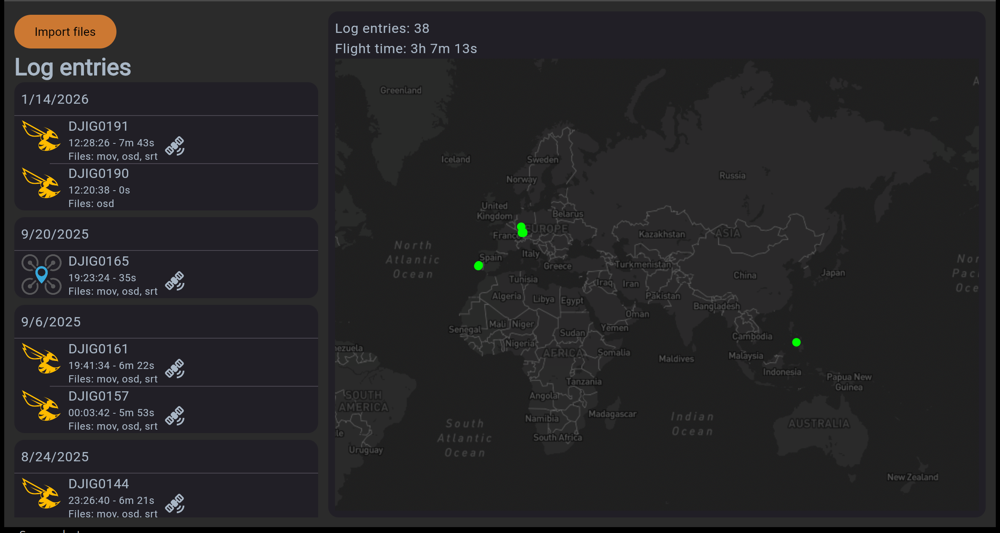
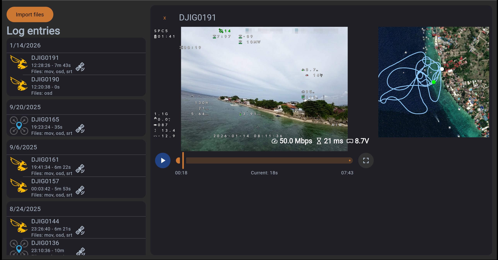
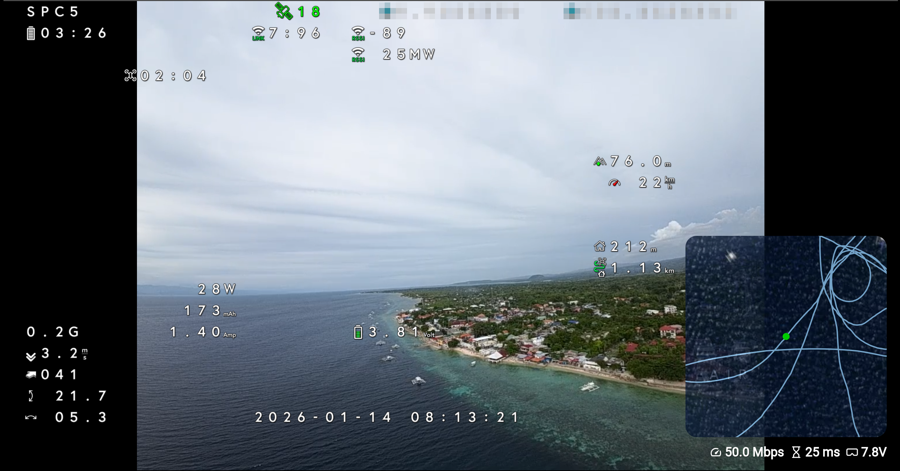

# WTF Flight Log

WTF Flight Log lets you review FPV recordings with their on-screen display (OSD), organize them into flight log entries, and view GPS tracks on a map.
It supports recordings from **DJI FPV systems** and **Caddx Ascent systems**.

**[Open the web app](https://timo-drick.github.io/WTF-Flight-Log/)**

The project also targets Android and Desktop (JVM). See [Development](DEVELOPMENT.md) for build and run instructions.

Please note that this project is under heavy development. OSD data has been tested with Betaflight and INAV; see the system guides for details.

## Supported systems

| System | Devices / recording support | Guide |
| --- | --- | --- |
| DJI FPV | DJI Goggles V1 and V2 with the original Air Unit or Vista; O3 Air Unit recordings. O4 is not supported. | [DJI WTF system](docu/DJI_WTF.md) |
| Caddx Ascent | Tested with the Walksnail Ascent FPV VRX Pro and Walksnail Ascent HD Lite+. | [Caddx Ascent system](docu/CADDX_ASCENT.md) |

## Features

- Import video (`.mp4` or `.mov`), OSD (`.osd`), and subtitle/telemetry (`.srt`) files and group matching files into log entries.
- Play recordings with OSD and subtitle overlays.
- Determine recording duration from OSD timestamps.
- Extract GPS coordinates from the recorded OSD and display flight tracks on a map.
- Export GPS data as KML for Google Earth.
- Group split video recordings into a single log entry when matching OSD and SRT data is available.

GPS tracks and flight statistics depend on the data present in the recorded OSD. Include latitude and longitude in your flight controller's OSD layout to use the map and KML export features.

## Getting started

1. Follow the guide for your system to prepare recordings: [DJI WTF](docu/DJI_WTF.md) or [Caddx Ascent](docu/CADDX_ASCENT.md).
2. Copy the video and its matching `.osd` and `.srt` files, if available, from your goggles or receiver.
3. Open the [web app](https://timo-drick.github.io/WTF-Flight-Log/) and choose **Import files** or **Import directory**.
4. Keep matching files together with their original filenames so the app can group them into one log entry.
5. Open a log entry to play the recording and inspect its flight data.

The `.osd` file contains the OSD character data needed to reconstruct the flight controller overlay and extract flight data.

## Screenshots

## Credits

The OSD support is based on [msp-osd](https://github.com/fpv-wtf/msp-osd) and [osd-dump-tools](https://github.com/Knifa/osd-dump-tools).

## Development

See [DEVELOPMENT.md](DEVELOPMENT.md) for instructions on building and running the project.
